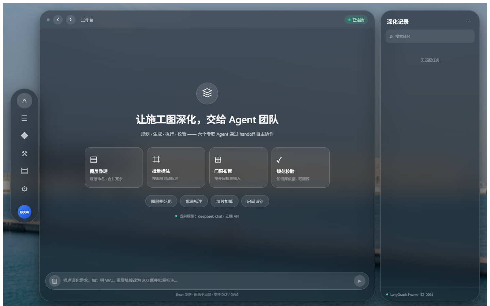

# CAD Agent · 施工图辅助深化

> LangGraph Swarm 多 Agent 架构的建筑 CAD 施工图深化系统。六个专职 Agent 通过 handoff 自主协作，规范知识库提供可溯源依据，单张图纸标注与图层整理耗时由约 30 分钟降至 10 分钟以内。

## 界面



空间计算风格：建筑摄影背景、深色毛玻璃悬浮面板、圆形图标导航。所有面板均为真实功能：工作台、任务管理、Agent 团队、MCP 工具目录、规范知识库、系统设置。

## 核心特性

- **LangGraph Swarm**：StateGraph + `Command(goto=...)` 实现 Agent handoff，保留 LangGraph 的持久化与流式能力
- **六个专职 Agent**：Planner / Coder / Executor / Validator / Deliver / Reviewer
- **API 模型为主**：默认 DeepSeek-V3（OpenAI 兼容），可选 GPT-4o / qwen-max / 本地 Ollama；图纸几何原文不出网，仅结构摘要参与推理
- **规范知识库**：PDF/DOCX/TXT 入库 → 语义分块 → 混合检索（向量+BM25+RRF）→ 为 Planner 与 Validator 提供依据
- **MCP 工具层**：工具发现、批处理、垂直工具包
- **双后端抽象**：ezdxf（离线）/ AutoCAD COM（在线）/ auto 自动探测降级

## 协作流程

```
用户任务 + DXF 图纸
        │
   [Planner] ── 检索规范知识库 → 制定计划
        │ handoff
   [Coder] ── 生成 MCP 工具调用参数
        │ handoff
   [Executor] ── 临时副本执行
        │ handoff
   [Validator] ── 知识库规范校验 + 语义判断
        ├─ 通过 → [Deliver] 交付
        ├─ 参数问题 → [Coder]
        ├─ 需求偏差 → [Planner]
        └─ 需人工 → [Reviewer]
```

Validator 可针对失败性质移交不同 Agent——这是固定流水线做不到的，拓扑运行时涌现。

## Agent 团队

| Agent | 职责 | 可移交 |
|---|---|---|
| Planner | 需求理解 + 规范检索 + 计划 | Coder / Reviewer |
| Coder | 计划转工具调用参数 | Executor / Planner |
| Executor | 临时副本执行 | Validator / Coder / Planner |
| Validator | 知识库规范校验 | Deliver / Coder / Planner / Reviewer |
| Reviewer | 人工复核协调 | Planner / Deliver |
| Deliver | 汇总交付 | — |

## 规范知识库

- **内置规范**：图层命名（ARCH_ 前缀）、标注样式（ARCH_DIM）、墙厚标准、门窗洞口、深化流程
- **文档入库**：支持 PDF / DOCX / TXT / MD，按语义分块，向量化索引
- **混合检索**：向量语义召回 + BM25 关键词召回 → RRF 融合
- **可溯源**：每条规范带来源文件与章节，校验结果标注依据

前端知识库面板支持：检索测试、来源浏览、文档上传入库。

## UI 功能一览

| 面板 | 功能 |
|---|---|
| 工作台 | 任务输入、拖拽上传、四节点执行流、handoff 轨迹、结果预览下载 |
| 任务 | 任务列表、状态筛选、搜索、打开历史、删除 |
| Agent 团队 | 六个 Agent 职责与 handoff 关系可视化 |
| MCP 工具 | 工具包筛选（core/arch/mech）、工具详情与参数 |
| 知识库 | 规范检索、来源统计、文档上传入库 |
| 设置 | 模型供应商切换、身份信息、系统状态 |
| 右侧栏 | 任务搜索与快速切换 |

## 模型配置

默认 `deepseek-chat`（API）。支持：

| 供应商 | 模型 | 环境变量 |
|---|---|---|
| deepseek | deepseek-chat | `DEEPSEEK_API_KEY` |
| openai | gpt-4o | `OPENAI_API_KEY` |
| qwen | qwen-max | `DASHSCOPE_API_KEY` |
| local | qwen3-32b | `SWARM_LLM_URL` / `SWARM_LLM_MODEL` |

**数据安全**：发送至 API 的只有图层名、实体统计等结构摘要，不含坐标与几何原文。设置面板可切换（管理员权限）。

## 快速开始

```bash
git clone https://github.com/wudidekongjv/CAD-agent.git
cd CAD-agent
# 配置 API Key
export DEEPSEEK_API_KEY=sk-xxx
cd docker && docker compose up -d
# 局域网访问 http://<服务器IP>:5173
```

## 技术栈

| 层 | 技术 |
|---|---|
| Agent 编排 | LangGraph StateGraph + Command(goto) |
| LLM | API（DeepSeek/GPT-4o/qwen-max）+ 本地 Ollama 备选 |
| 知识库 | 向量 + BM25 + RRF（轻量实现） |
| 工具协议 | MCP（FastMCP + stdio） |
| 绘图引擎 | ezdxf / AutoCAD COM / auto |
| 后端 | FastAPI + SQLite + Redis + SSE |
| 前端 | Vue3 + Vite + 毛玻璃空间计算 UI |
| 部署 | Docker Compose |

## 仓库结构

```
├── src/
│   ├── swarm/          # LangGraph Swarm 运行时 + 六 Agent
│   ├── knowledge/      # 规范知识库（入库/检索/校验）
│   ├── mcp/            # MCP 工具层
│   ├── backend/        # 双后端抽象
│   └── api/main.py     # FastAPI 接口（含知识库/模型/工具面板）
├── web/src/            # Vue3 全功能前端
├── docker/
└── docs/
```

## License

MIT
